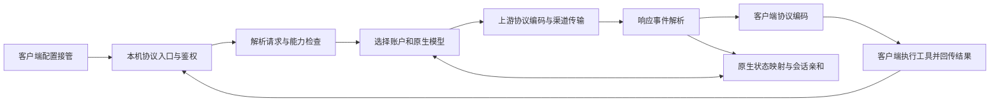

# Agent 网关转发与协议兼容设计

本文说明 Claude Code、Codex、Gemini CLI 通过本机网关使用不同供应商模型时的转发结构、兼容边界与实现顺序。目标是让客户端保持自己的协议，由网关完成路由与协议转换，而不是要求客户端统一改用 Chat Completions。

原始调研基线：2026-11-06 的工作区，基于提交 `4ff22f4`，包含尚未提交的网关与本地工具改动。下文基线分析中的“当前／待实现”描述对应调研时点；最新实现与剩余边界以上述实现状态为准，尚未发布。

## 本次实现状态

文中原始调研基线保留用于解释设计取舍。当前工作区已实现前三阶段的主要链路：

| 范围 | 已实现 |
| --- | --- |
| 协议与入口 | 四协议、十二个跨协议方向；Gemini JSON／SSE、列表／单模型查询；Messages 已知 beta 查询参数 |
| 计数 | 原生 Messages `count_tokens`、原生 Gemini `countTokens` 转发；跨协议及订阅渠道没有精确计数时返回 `TOKEN_COUNT_UNSUPPORTED`（422），不返回估算零值 |
| 原生状态 | 签名 thinking、redacted thinking、Responses 加密推理、Google 工具签名及原生工具 ID 的工具闭环恢复；工具参数按规范化 JSON 摘要校验 |
| 状态归属 | 供应商连接、账户、原生模型绑定；存在有效会话头时绑定会话；账户刷新优先使用认证主体，缺少主体时使用凭据指纹，严格拒绝无法确认归属的恢复 |
| 状态寿命 | 每个网关最多 1024 条、16 MiB、30 分钟；停止时清空；失效、账户／模型变更或历史不全返回明确的 409，不删除历史重试 |
| 流式处理 | Gemini 文本实时转发，完整工具快照按 ID／位置更新，在终结帧后发布工具；同协议 SSE 聚合保留原生签名及密文 |
| Codex 工具 | Responses 自由文本工具、命名空间工具的函数化转发；还原 custom_tool_call、输入 delta／done 和原始 namespace；保留多轮 ID 配对 |
| 客户端工具发现 | Responses client tool_search、tool_search_output 动态 Schema、deferred 工具激活及 developer additional_tools 历史位置标记 |
| 特性与用量 | 同协议白名单特性头，订阅适配器合并所需 beta；跨协议不透明头不透传；缓存写明细与推理 Token 不重复计入总量 |
| 模型目录 | 原生 Gemini 分页、显示名称和输入／输出上限；未返回的能力保持未知 |
| 本地工具 | Gemini CLI 可执行文件探测；用户 `settings.json` 与 `.env` 字段级事务、加密备份、移除恢复；现有工具接入保持不变 |
| 配置来源 | 返回宿主已导出的 Gemini 覆盖变量名称，不返回值；界面提示项目 `.env` 与启动参数可能覆盖用户配置，不修改项目文件 |

兼容边界仍需明确：

- Responses 客户端工具搜索已按下文实现；服务端托管搜索、Messages 工具搜索／工具引用、异步工具及有状态请求在跨协议无法表达时明确拒绝，同协议由对应上游支持。自由文本工具已通过字符串参数包装实现转换，语法约束转为上游提示，最终由客户端校验执行。
- 不能在其他协议中可靠承载的无工具调用签名／密文回复返回 `NATIVE_STATE_REQUIRES_TOOL_CALL`，不会悄悄丢失原生上下文。带签名的客户端历史不能直接移交其他供应商。
- Gemini 的缓存引用、安全配置、未支持的生成参数、非图片内容与特殊工具增量明确拒绝；原生同协议流量保留原始字段。带签名的普通文本跨协议暂不支持，签名 thought 与工具调用可通过上述映射恢复。
- 原生状态仅在内存中保存，跨重启恢复未实现。Responses 查询／删除／压缩和 WebSocket 属于后续独立阶段，当前没有宣称支持。
- 配置诊断能够读取宿主环境；没有客户端启动目录及实际命令行时，无法证明项目 `.env` 或 `--model` 是否生效，因此“配置已接入”不等于真实 CLI 已完成推理验证。

验证使用临时目录、假凭据和本地 HTTP／SSE 上游。自动化覆盖四协议转换、原生签名多轮调用、参数改动与账户切换拒绝、状态过期和容量、流式截断、缓存用量、目录分页、精确计数及 dotenv 恢复。不会把模拟通过描述为所有在线模型均兼容。

本次验证记录：Core 783 项通过、3 项跳过；Dashboard 195 项通过；Tauri 102 项通过。Core／Dashboard 构建与 Electron 类型检查通过。Claude Code 2.1.318 使用临时配置连接本地模拟上游，实际 CLI 返回 `OK`，网关记录为 Messages 200 completed。未使用该结果代替 Gemini CLI、Codex 或真实在线供应商的完整验收。

### HY4 与 Claude Code 的真实链路修复

2026-11-06 对当前运行的本机网关进行实测：WorkBuddy `hy4free` 能完成 Chat 推理，但原样 Claude Code 2.1.318 的 Messages 请求返回 `UPSTREAM_HTTP_400`。受控对照保持模型、提示词、生成参数和上游不变，仅去掉 SDK 首个系统块中的 `x-anthropic-billing-header` 后成功，真实 CLI 返回 `OK`。这说明模型目录可见或简单请求 200 不足以证明完整客户端可用。

修复在跨协议转换时，只移除首个、完整匹配已知 SDK 格式的计费系统块。普通用户文字、混有用户指令的文本块和原生 Messages 请求保持不变。网关不删除工具历史或签名来重试。

Claude Code 的受管理 CLI／VS Code 接入及临时会话默认启用 `ENABLE_TOOL_SEARCH=true`。工具搜索和执行由客户端完成，通用协议层转换延迟定义及 `tool_reference`，向跨协议上游只提供基础工具和已经加载的工具，不把整个 MCP 工具库展开进上下文。用户已有或后来修改、删除的搜索偏好保留；旧策略仍由网关拥有的 `false` 自动迁移。配置修改对新会话生效，不改写旧会话上下文。

开发重载还暴露出网关开关状态未保存的问题。桌面宿主现在将显式选择原子写入 `agent-router/enabled.json`，重启恢复；显式 `TUD_AGENT_ROUTER_ENABLED` 启动变量仍优先。退出进程不会被当成用户点击“关闭网关”，重复启动时的持久化失败不会停止已运行的网关。

修复已加载到当前监听 `127.0.0.1:18453` 的网关。真实上游验收包括：默认 Claude CLI 正常回复 `OK`；限定 Read 工具读取临时文件，回传结果后第二轮正确回答。三个 Messages 请求均为单次上游尝试、200、完整结束。测试只允许读取临时验收文件，未开放 Shell 或写入工具权限。此结果覆盖当前 HY4 路由与上述场景，不代表所有渠道、所有 MCP 工具或旧签名会话均兼容。 后续复验还观测到一次 `FIRST_RESPONSE_TIMEOUT`（30 秒）及其触发的冷却；冷却后默认系统提示请求和 Read 闭环均成功。未通过提高超时、清除健康状态或改换模型掩盖这次失败，因此这项修复不能承诺上游全程无故障。新开 Claude Code 会话可加载工具搜索兼容设置，旧进程不保证热更新环境变量。

### 交互式项目会话的补充修复

用户在 Claude Code 2.1.319 的实际项目会话发送“你好”仍返回 400，表明此前打印模式验收不能代表交互模式。核对失败会话记录后，发现实际请求有 54 个工具及约 7 KiB 系统指令。保留这 54 个工具、换用短系统提示成功；保留完整系统提示、移除工具仍失败；进一步对照发现，固定身份块 `You are Claude Code, Anthropic's official CLI for Claude.` 单独发送也返回 400，其余完整系统指令单独发送成功。

修复限定于 WorkBuddy 适配器：只有 system 消息以已知的完整客户端身份句开头，且后面为换行或文本结束时，才将该句转换为通用本地编码助手身份。其余完整指令、所有工具 Schema 和用户消息保持不变；共享协议层及其他渠道不做这项替换。SDK 计费块解析同时改为识别完整字段记录，兼容新增 `cc_*`／`cch` 字段，不匹配普通文字或混合指令。

补充验收：使用失败记录中的完整系统提示与 54 个工具，对当前网关发送“你好”，获得 200、文本输出和完整终结。随后在相同项目目录启动真实交互式 Claude Code 2.1.319，通过终端输入“你好”；观察到交互模式身份块、实际项目系统提示和工具列表的原始请求，诊断转发器未改写请求体，当前网关返回 200、`message_stop`，客户端终端显示正常回复。该交互测试启动时加载的工具数为 27；54 工具的对照请求单独覆盖，不能将两者描述为完全相同的单次请求。

测试终端触发的新版本渲染提示曾改变显示偏好，已恢复原偏好；这轮误操作未产生推理请求，未计入有效验收。临时诊断会话关闭后，原网关保持运行，用户业务会话不被清理。

### 当前选中 Codex 路由的补充修复

随后用户再次报告 400。核对 2026-11-06 23:37 的四次真实失败记录，目标已是 Codex 订阅账户的 `gpt-6.1-sol`；运行进程已加载此前 HY4 修复，因此不是旧运行包未刷新。此时必须按当前选中的实际路由验证，不能用另一供应商的通过结果替代。

Claude Messages 的 system 指令经过通用转换后成为 Responses 的显式 system 输入项。Codex 订阅路线对这类输入有限制：使用 instructions 或 developer，HTTP 输入为完整上下文数组。[官方约束](https://developers.openai.com/siwc/token-sharing-open-source/preview-limitations)。修复限定在 Codex 订阅适配器中，将这些输入项转为 developer，保持原内容、顺序、工具调用及密文不变；字符串 input 规范化为 user 消息数组，普通 API 供应商不受影响。

消除 400 后，实测发现该上游会将成功 SSE 标为 application/json。同协议直接转发能读到完成事件，跨协议转换却误按 JSON 解析而失败。订阅适配器现统一成功流响应的 Content-Type 为 text/event-stream，保留原字节和取消传播；非成功 HTTP 响应保留原状态及 JSON 类型。

最新实测使用当前选中的 `gpt-6.1-sol`：同一项目的真实交互式 Claude Code 输入“你好”，请求体不经诊断转发器改写，返回 200、完整 Messages 终结，终端显示回答；随后真实 CLI 的 Read 工具读取临时文件，回传后第二轮回答正确。该问候与工具闭环共三个 Messages 请求，均为单次上游尝试、200、完整结束。Core 783 项通过、3 项跳过，Tauri 102 项通过；当前网关维持原 18453 端口，模型选择保持当前值。

### Codex 自由文本工具与真实多轮验收

2026-11-07 补齐 Responses 自由文本工具与命名空间。此前 `custom`／`namespace` 被统称为不支持，无法覆盖 Codex 的 `apply_patch`。现在将自由文本工具转换为只有一个 `input` 字符串的函数，保留工具描述及 Lark／regex 语法提示；响应按原请求恢复 `custom_tool_call` 和输入 delta／done。跨帧 JSON 转义完成后才发布原始输入，换行、引号、反斜线及 Unicode 不被改写。缺失或非字符串输入明确失败，不将无效参数猜成补丁。

命名空间使用带碰撞检查的稳定工具别名，上游名称满足供应商约束，返回时恢复原名与 namespace；不同命名空间的同名函数保持独立。调用／返回历史转换仍经过原生状态的参数摘要和账户绑定检查，新增自定义工具引用识别。

真实 Codex CLI 0.166.0 暴露了第二个问题：WorkBuddy 拒绝 Responses 客户端的 developer 指令角色。对照同一请求，增加输出预算或去掉 reasoning 仍为 400，仅将 developer 改为 system 后完成。修复仅放在 WorkBuddy 适配器中，保持内容数组、指令顺序、工具和用户文字。

真实 CLI 使用与配置接管相同的模型目录生成逻辑，忽略用户配置、关闭项目指令读取，在临时 workspace-write 沙箱中要求只用 apply_patch 创建校验文件。WorkBuddy `hy4free` 与 Antigravity `gemini-2.5-flash` 均出现真实 `file_change` completed、文件内容正确、工具结果回传及 `turn.completed`；分别经 2 次、3 次 Responses 请求完成，上游全部 200。第三次请求的原因未单独判定，不据此宣称固定两轮。未执行 Shell 或子代理任务。

验收期间本机 Codex 供应商条目已被移除；没有恢复配置，也没有将旧渠道的测试结果冒充当前在线验收。此前渠道盘点见 [检查记录](./agent-gateway-channel-audit.md)。Core 完整回归 796 项通过、3 项跳过，随后新增的命名空间并行返回用例单独通过；专用工具测试共 11 项通过。

可重复的真实验收脚本：[check-codex-gateway.mjs](../scripts/check-codex-gateway.mjs)。先构建 Core，再使用当前开放的完整模型 ID 运行；脚本默认禁止真实推理，必须明确传入 `--live --model provider-id/model`。要求 Codex 支持 `--ignore-user-config`，不会覆盖用户配置；本机令牌只在子进程环境中传递。脚本要求真实文件修改事件、正确文件、最终校验串和正常终结，遇到失败退出码为 1。

[脱敏真实验收记录](./agent-gateway-codex-tools-results.json) 保存两个渠道的请求类型和状态。新增脚本复验 WorkBuddy 也通过。脚本初次验收恰逢开发重载：文件修改已完成，但后续请求中断，记录为失败；等待当前网关稳定后复验通过，未将中断记录解释为模型兼容成功。

```sh
pnpm --filter @juejin-opensource/jusage-core build
node scripts/check-codex-gateway.mjs --live --model provider-id/model
```

上述自定义工具验收不覆盖工具搜索。后续客户端工具发现的实现及验证见下一节；异步调用、长流和 Responses 状态存储仍需独立验收。

### Responses 客户端工具搜索

依据 [官方工具搜索协议](https://developers.openai.com/api/docs/guides/tools-tool-search)，将 `execution: client` 的搜索工具作为上游普通函数提供。模型回复还原为 `tool_search_call`，参数是对象、归属仍为 client，使用标准 output_item added／done 和完整响应终结事件，不生成虚假的服务端搜索结果。

客户端通过 `tool_search_output` 明确提供可加载的函数或自由文本工具 Schema。转换器每轮从完整历史中重建已发现工具，保留命名空间并恢复搜索／后续调用的原生 ID；下一轮不需要重复全局 tools。声明为 deferred 的 Schema 在加载前不发送给上游。重复搜索返回相同工具时去重，别名冲突、无效 Schema、异步工具及托管执行归属仍明确拒绝。

`additional_tools` 仅接受 developer 角色；在历史原位置保留“工具从这里可用”的指令标记，同时将已加载定义纳入当前请求的工具列表。跨协议不声称具备目标模型原生的动态缓存或加载机制。

工具名和参数可能在同一帧同时分片。编码器现在等待名称与已声明工具唯一匹配后再决定客户端类型；自定义输入和搜索对象参数在完整后发布，其余可确认名称的函数参数仍保持增量流。未声明的工具名明确失败，不把一个不完整的工具名发送给客户端执行。

新增测试覆盖 Chat、Messages、Gemini 三种上游、客户端 JSON 与 SSE 两种响应形式的三轮 HTTP 闭环：搜索调用 → 返回命名空间中的自定义工具 → 调用与工具结果 → 最终文本；另有历史持久可见性、additional_tools 顺序、服务端归属拒绝、参数绑定、Schema 校验、分片类型判断和单调事件序号检查。完整 Core 回归 807 项通过、3 项跳过，后续输入校验改动另行运行相关回归。

真实推理检查脚本：[check-tool-search-gateway.mjs](../scripts/check-tool-search-gateway.mjs)。必须显式使用 `--live --model provider-id/model`，可加 `--non-streaming` 验证 JSON 聚合。脚本实际读取临时校验文件，只执行固定路径的本地读取，不执行模型生成的 Shell。每个阶段要求完整响应，检查搜索归属、发现后的工具名称／命名空间、原始输入及最终文件校验串；失败不重试或切换账户。

2026-11-07 实测：[脱敏记录](./agent-gateway-tool-search-results.json) 包含 WorkBuddy `hy4free` 与 Antigravity `gemini-2.5-flash` 各自 SSE／JSON 两种模式，共四组完整闭环、12 次上游请求，全部为 200 且完整终结。初始请求只有客户端搜索和 deferred 声明，后续请求未重复全局 tools；本地客户端确实按生成的自定义工具名称与输入读取校验文件，最终回复匹配文件内容。额外测试确认篡改搜索参数的历史在调用上游前返回 409。

同协议第三方 Responses 的搜索与原生聚合现已按下一节处理，不能把跨协议实测代替该分支的验证。Messages 的托管搜索是另一套机制，本节没有将它标记为已支持。

### 原生 Responses 与流完整性

原生 Responses 的 SSE 聚合不再经过会丢失原生内容类型的通用事件表示。优先保留完整终结响应；旧上游缺少完整 output 时，从已收到的完整 item 快照和已支持增量重建。原始 ID、加密推理、自定义输入、托管工具项、用量、引用及供应商扩展保留。无法重建的未知内容、与已收到内容冲突的空 completed output、错误及截断明确失败。JSON-only Responses 上游也可输出合法 SSE：提供原生 item、文本／拒绝／自定义工具增量与终结事件，完整快照保留不透明字段。

第三方 Responses 请求中的客户端搜索函数化处理不再需要绕行 Chat。只改写搜索调用／结果和加载工具定义，保留 custom／namespace、原生历史、previous_response_id、store 等其他字段。已知支持原生搜索的 Codex 订阅保持原接口。搜索回复还原为客户端归属及对象参数，事件序号重新单调编号；携带本网关状态引用的历史仍先校验归属，不绕过参数和账户绑定。

原生 SSE 直通新增按源协议检查终结事件。压缩传输先解码并移除失效的 content-encoding，包含 identity 和大小写 MIME 的检查；内容已经提交后断流不切换上游或重放。首个有效内容前的前缀预算与后续单帧上限分开，后续 400 KiB 帧不再被 256 KiB 前缀预算误判。运行时测试中的不完整“成功流”和非 JSON SSE 假数据已改成符合其测试目的的真实协议形态。

验证见 [记录](./agent-gateway-native-response-validation.json)、[原生 Responses 测试](../packages/core/test/agent-router-native-responses.test.ts)、[同协议搜索测试](../packages/core/test/agent-router-native-search.test.ts)。独立本地 HTTP 上游覆盖上游 JSON／SSE × 客户端 JSON／SSE 四种组合的搜索、原生自定义工具和结果闭环，以及 gzip、错误、截断、状态引用和字段保留。完整 Core 回归 827 项通过、3 项跳过；随后补充的原生 JSON→SSE 字段测试所在文件 10 项通过。

当前启用的三个渠道上游协议均为 Chat，未恢复已移除的 Codex 供应商，因此没有将这些本地 HTTP 测试描述成真实第三方 Responses 供应商验收。现有真实渠道复验：WorkBuddy hy4free 与 Antigravity gemini-2.5-flash 的八项客户端协议推理通过；WorkBuddy 的真实 Claude Read 与 Codex apply_patch 闭环通过。Antigravity 的 Claude Read 测试 65 秒超时；该时间窗口先有小请求 200，随后记录三次提交前 429。尚未判定是限流、额度还是请求预算差异，不能记为工具闭环通过。

## 1. 先区分客户端、协议和上游渠道

Claude Code 和 Codex 是客户端；Messages、Responses、Chat Completions、Gemini GenerateContent 是接口协议；API Key、订阅 OAuth、原生 CLI 则是上游渠道的访问方式。三者不能混为一谈。

| 客户端 | 请求网关时使用的主要协议 | 当前本机入口 | 当前边界 |
| --- | --- | --- | --- |
| Claude Code | Anthropic Messages | `POST /v1/messages` | 已接入；兼容 SDK 的 `?beta=true` |
| Codex | OpenAI Responses | `POST /v1/responses` | 已接入 HTTP；未提供 WebSocket 升级与本地 Responses 状态存储 |
| OpenCode、Pi 等兼容客户端 | OpenAI Chat Completions | `POST /v1/chat/completions` | 已接入；实际工具能力仍受上游限制 |
| Gemini CLI | 接管为 API Key 模式后的 Gemini GenerateContent | 已提供 `/v1beta/models/*` | 已实现转换与配置接管，真实模型能力仍受上游限制 |

调研基线的 `Protocol` 只有三种；本次已增加 `gemini`，四协议之间共有十二个跨协议转换方向。同协议正常响应优先保留原始字节；非流式客户端遇到强制 SSE 的上游时仍需聚合为 JSON。

Antigravity 渠道已经把 Google 原生请求包装成内部 Chat 传输接口。这使 Claude Code 等客户端可以请求该渠道的模型，但**不等于网关已经支持 Gemini CLI 的原生 HTTP 协议**。

当前代码入口见 [gateway.ts](../packages/core/src/agent-router/gateway.ts)、[协议转换](../packages/core/src/agent-router/protocol/README.md)、[原生渠道](../packages/core/src/agent-router/native/README.md)。

## 2. 转发结构与实现取舍

对照多种转发实现后，可归纳出两种结构：统一请求与事件中间层，以及按客户端与上游协议分别维护转换器。前者便于复用流式编码和路由，后者容易表达特定供应商的例外。当前工程已有统一事件层，后续应在它之上保留供应商扩展状态，将例外限制在对应适配器内，避免继续叠加按模型名称分支的补丁。



这张图描述当前转发结构；持久化原生状态、压缩和 WebSocket 不在本次实现内。

实现时应固定以下约束：

- 客户端看到网关模型 ID，上游只收到该账户对应的原生模型 ID。模型 ID 可能包含 `/` 和 `:`，不能用一次简单分割代替路由解析。
- 先按客户端协议解析，再按上游协议编码；只转换已明确支持的字段。不认识的工具或内容类型应明确失败，不能悄悄丢弃。
- 普通文本、可见推理文本和供应商签发的不透明状态分别处理。能显示推理摘要，不代表能恢复签名或密文。
- 网关返回工具调用，由客户端执行。协议转换层不在用户机器上执行模型生成的 Shell、文件操作或 MCP 工具。
- 客户端鉴权和供应商鉴权独立。客户端拿到的本机令牌不能变成任意上游地址或账户的通行证。

外部实现中存在估算 Token、将不透明状态放入调用 ID、移除不兼容历史项后重试等兼容手段。本工程不直接照搬：估算不能标记为精确计数，调用 ID 不能无限增长，历史内容不能在用户不知情时被删除。

## 3. 三类客户端的接入细节

### 3.1 Claude Code

当前工具接管写入用户级 `settings.json`，配置网关根地址、网关令牌、默认模型和模型选择列表。CLI 和 VS Code 扩展有独立接入记录；Claude 桌面应用使用独立的第三方推理设置，目前提供手动引导。

必须检查完整请求链，而不只检查模型目录：

1. 客户端实际使用哪个 Base URL、令牌来源和模型 ID。
2. `POST /v1/messages?beta=true` 能否经过鉴权进入推理。
3. 工具声明、工具结果、流式事件和下一轮历史是否保持一致。
4. 辅助请求是否需要兼容，例如模型查询、Token 计数和工具搜索。

本轮已验证过一个具体失败：模型目录包含所选模型，直接调用 `/v1/messages` 也成功，但 SDK 在路径后附加 `beta=true` 后被入口拒绝为 404，客户端显示为“模型不可用”。当前入口已只对 Messages 放行这个已知参数；它不会作为任意查询参数转发到上游。

待补齐：`/v1/messages/count_tokens`、按模型查询的接口兼容性评估，以及 `defer_loading`、`tool_reference`、工具搜索等较新特性的能力判断。未支持时给出具体错误，不能仅凭普通文本用例成功就标记整个客户端兼容。工具搜索的默认行为会随 CLI 版本变化，应记录验证版本。[官方错误说明](https://code.claude.com/docs/en/errors#theres-an-issue-with-the-selected-model)

客户端的配置优先级也会影响结果。检查命令行、进程环境、用户设置、项目设置和组织策略，但诊断日志只保留来源与脱敏摘要，不输出配置全文。[设置优先级](https://code.claude.com/docs/en/settings)

### 3.2 Codex

当前配置接管在 `config.toml` 中添加 `jusage` 供应商，使用 Responses 协议，并提供工具的模型目录。模型目录应准确表达能力，不能靠虚假的上下文长度或工具能力让客户端继续执行。

Responses 的一次对话是有序的输入项序列，不只是文本消息。必须分别保留：

| 项目 | 转换要求 |
| --- | --- |
| `instructions`、`developer`、`system` | 保留指令语义和顺序；只有特定上游要求首条 system 时，才在适配器内做有测试覆盖的调整 |
| `function_call` | 保留 `call_id`、名称和参数；区分事件 item ID 与工具调用 ID |
| `function_call_output` | 对应原始调用；并行调用不能被拆成错序的工具结果 |
| `custom_tool_call` 等自由文本工具 | 与 JSON 函数工具分开；例如补丁文本不能直接当 JSON 参数解析 |
| `reasoning`、`encrypted_content` | 文本摘要与密文分开；原生状态只返回签发它的上游 |
| `previous_response_id`、压缩项 | 依赖历史状态；跨协议转发必须有明确的恢复策略 |

当前跨协议转换会拒绝有状态 Responses、无可恢复引用的密文推理和内置工具等无法表达的功能；自由文本自定义工具按上述字符串函数包装处理。同协议请求不经过请求体转换，但仍受上游实现及网关入口范围限制。网关目前没有提供本地 Responses 查询、删除、压缩或 WebSocket 会话服务。

后续不能把 `/responses/compact`、WebSocket 和普通 HTTP Responses 混成一个“已支持”状态。应先完成 HTTP 多轮工具调用，再独立决定是否实现压缩与 WebSocket，并让客户端配置与实际能力一致。[Codex 配置参考](https://developers.openai.com/codex/config-reference/)

订阅渠道也是独立的传输问题：现有 Codex 渠道需要账户身份头，并强制上游 SSE；非流式客户端通过完成事件取回 JSON。普通 API Key 渠道不能无条件套用这些订阅头。

### 3.3 Gemini CLI

**以下接入约定已实现，限制见“本次实现状态”。** 原生入口至少覆盖：

| 方法与路径 | 处理方式 |
| --- | --- |
| `POST /v1beta/models/{model}:generateContent` | 输出 Gemini JSON 响应 |
| `POST /v1beta/models/{model}:streamGenerateContent?alt=sse` | 输出 Gemini SSE |
| `POST /v1beta/models/{model}:countTokens` | 优先使用对应上游的计数接口；无可靠计数能力时明确说明限制 |
| `GET /v1beta/models` | 返回本机令牌有权访问的模型目录 |
| `GET /v1beta/models/{model}` | 返回该模型的可用元数据或明确的不存在错误 |

路径解析应从末尾的动作分隔符识别方法，并对模型部分按框架实际解码情况处理一次。需同时覆盖 SDK 编码后的 `/`、模型名里的 `:`、非法编码和重复版本前缀。不能直接把路径中的模型部分拼接为任意上游 URL。

请求映射包括 `contents`、`systemInstruction`、`generationConfig`、`tools.functionDeclarations` 和 `toolConfig`。回复映射包括 `candidates`、`content.parts`、`finishReason`、`promptFeedback` 和 `usageMetadata`。接口形状以 [GenerateContent 参考](https://ai.google.dev/api/generate-content) 为准，不与另一套有状态交互接口混用。

用户级配置接管约定（本次已实现）为：

```json
{
  "security": { "auth": { "selectedType": "gemini-api-key" } },
  "model": { "name": "provider-a/model-x" }
}
```

```dotenv
GOOGLE_GEMINI_BASE_URL=http://127.0.0.1:18453
GEMINI_API_KEY=<网关访问令牌>
GEMINI_MODEL=provider-a/model-x
```

端口仅为示例，以实际网关地址为准。Base URL 使用根地址，由客户端 SDK 添加版本与模型路径。客户端可以使用 API Key 模式访问本机网关，上游仍可由网关使用 OAuth；这不要求把供应商 OAuth 凭据写入客户端。Gemini CLI 的 Google 登录／Code Assist 模式与该入口不同，不能只替换它的服务地址就假定协议相同。

配置文件涉及 `~/.gemini/settings.json` 和 `~/.gemini/.env`。项目 `.env` 可能先于用户级文件被找到，且不是把所有 `.env` 自动合并；模型选择还可能被 `--model` 或 `GEMINI_MODEL` 覆盖。因此接管后必须核对有效来源，不能只检查用户文件写入成功。[认证与环境文件](https://github.com/google-gemini/gemini-cli/blob/main/docs/get-started/authentication.mdx)、[模型选择顺序](https://github.com/google-gemini/gemini-cli/blob/main/docs/cli/model-routing.md)

配置事务现已支持 JSON、TOML、YAML、dotenv。dotenv 编辑保留无关条目、注释、引号、export 前缀和换行格式；无外部修改时移除接入恢复原始文件，有外部修改时只恢复仍由网关管理的字段。重复键、未闭合引号等歧义格式拒绝接管。

## 4. 转换不能丢失的请求语义

当前请求以 Chat 形状作为中间表达，响应以中立事件表达。它们适合普通文本与函数工具，但不能完整承载所有原生字段。后续扩展应保持以下信息边界：

| 信息 | 必须保留的内容 | 不能使用的替代方式 |
| --- | --- | --- |
| 内容块 | 角色、有序文本／图片／工具调用／工具结果 | 把所有内容拼成一段文本 |
| 工具调用 | 原始名称、客户端 ID、上游 ID、参数形态、并行顺序 | 给同名工具匹配最近一次调用 |
| JSON Schema | 参数约束及所选上游支持的表达 | 遇到报错就删除 `required` 或所有未知字段 |
| 结构化输出 | schema、严格程度和响应格式 | 只在提示词里要求“返回 JSON” |
| 推理 | 可见摘要、真实签名、原生密文分别保存 | 把推理文本伪装为签名 |
| 生成控制 | 输出上限、停止条件、采样、工具选择 | 依据模型名称猜一个推理预算 |
| 上游扩展 | 字段的协议、供应商、账户和模型归属 | 给所有模型注入同一组私有参数 |

Gemini 函数声明的 `parameters` 与 `parametersJsonSchema` 是不同表达入口，且互斥。原生 Schema 转换会规范化大写类型、可空约束和字符串整数上限；JSON Schema 入口保留原约束，不通过删除字段规避错误。[官方字段参考](https://googleapis.github.io/js-genai/release_docs/interfaces/types.FunctionDeclaration.html)无参数函数可以规范化为明确的空 object schema；复杂联合类型、引用、枚举等必须通过专门测试，不能以牺牲约束为代价“修好请求”。

模型元数据已经可以表达图片、推理、工具调用和 Token 上限，但当前主要用于目录展示，尚未完整接入运行时转换判断。未知能力不等于支持；也不能因目录未返回某字段就自动断言不支持。后续能力检查需要同时考虑客户端特性、目标协议表达能力和上游明确能力。见 [模型元数据](model-metadata.md)。

## 5. 流式响应必须作为状态机处理

响应中间层应表达消息开始、内容块开始、文本／推理／工具参数增量、用量、完成原因、错误，以及仅在网关内部使用的原生状态信息。当前 `Event` 只有文本、推理文本、工具、用量和结束原因，缺少原生签名及不透明状态的承载位置。

SSE 解析要处理 UTF-8 分片、CRLF、多行 `data:`、注释心跳、单帧与总量上限、压缩、背压和取消。完整收集后再生成 JSON，只适用于非流式客户端，不能让正常流式响应一直等到结束。

| 协议 | 需要保持的结束语义 |
| --- | --- |
| Messages | `message_start`、内容块事件、`message_delta`、`message_stop` 的顺序与配对 |
| Responses | `response.created`、item／参数事件及 `response.completed` 或 `response.incomplete` |
| Chat Completions | tool call index、参数增量、`finish_reason` 与 `[DONE]` |
| Gemini | candidate／part 的对应关系、`finishReason`、拦截反馈和用量 |

工具名称和参数可能分片到达。不能在名称尚不完整时提交一个错误的工具开始事件，也不能把并行调用的参数交叉追加。对于会重发累积快照的渠道，应按原生调用 ID／稳定索引更新快照；对真正的增量继续追加，不能简单按“文本是否重复”去重。

正常停止、需要执行工具、输出上限、内容拦截和失败必须区分。上游断流、错误事件或缺失终结事件，不能补成正常成功。现有三协议转换已覆盖部分这些约束，Gemini 新适配器需要同样的独立线格式测试。

## 6. 多轮工具调用与原生状态

### 已识别的状态缺口

Antigravity 适配器已读取并生成 `extra_content.google.thought_signature`；但当前跨协议 `Event` 没有该字段，转换后的 Messages 工具块也没有配套的还原映射。静态核对说明存在状态丢失风险，不能据此声称所有模型都已触发同一故障。

Gemini 原生 `Part.thoughtSignature` 是用于后续请求复用的不透明信息，不能根据摘要或模型名重新计算。[原生 Part 字段](https://ai.google.dev/api/generate-content#Part)

Responses 的加密推理、Messages 的签名 thinking、原生工具 ID 也有类似归属问题。账户切换、模型切换、会话裁剪或工具 ID 被客户端缩短，都可能使旧状态无法继续使用。

### 待实现的保存与恢复

网关保留真实上游状态，并以短的客户端工具 ID 关联原生 ID、原始块和签名。状态记录绑定供应商、账户身份、原生模型和调用身份；有可信会话标识时再加入会话范围。匹配时核对工具名称与参数摘要，不能仅凭同名工具或历史中的位置恢复。

状态容器应有容量上限、有效期和释放机制，不进入普通请求日志。跨重启恢复是单独能力；如需持久化，使用现有加密存储并限定保留时间。网关只恢复原始不透明值，不解密，也不把一个账户的原生状态带给另一个账户。

当状态缺失或失效时，应明确说明无法恢复该轮原生上下文，允许用户重新开启会话。若未来提供无状态降级，需有明确的内容保留规则和可见提示；默认不删除工具结果、压缩历史或密文中的唯一任务内容，也不自动伪造签名或跳过验证。

## 7. 鉴权、路由与失败处理

### 入口与上游分别鉴权

现有本机入口验证 Host、Origin 和网关令牌，管理接口与推理接口分离。Gemini 原生入口新增后，应识别其 SDK 的鉴权位置，并在入口转换为统一的本机身份；上游 `x-goog-api-key` 或 OAuth Bearer 由渠道重新构造。若兼容 URL 中的密钥参数，必须从路径记录及上游转发中移除。

请求头分为三类：本机鉴权、客户端协议特性、供应商鉴权。`anthropic-version`、beta 功能和客户端特性声明需要显式兼容表，不能把客户端的全部头部直接发给其他供应商。目前传输层会重建鉴权头，客户端特性头尚未形成完整的跨协议映射，这是待补齐项。

上游 URL 来自已验证的渠道配置，而不是客户端传来的目标 URL。自身回环检测应覆盖监听地址、端口和可解析到自身的别名，防止配置接管后递归转发。

### 重试以是否已向客户端提交内容为边界

| 失败情形 | 处理原则 |
| --- | --- |
| 未路由到模型、模型被关闭 | 返回明确错误，不消耗上游请求 |
| 本机鉴权失败 | 停止，不尝试其他供应商 |
| 上游 401 | 标记账户认证问题；不能把它伪装为模型缺失 |
| 上游 429 | 尊重 `Retry-After`，进入冷却；只在提交前按既有策略选择其他候选 |
| 上游 5xx、连接失败、首个有效响应超时 | 仅在提交前考虑重试，限制次数与总时长 |
| 上游 400、协议不支持 | 默认直接返回；仅对明确可识别且无内容丢失的修正允许有限重试 |
| 已向客户端提交文本、推理或工具事件 | 不切换供应商或重放；以当前协议报告错误或中断 |
| 用户取消、窗口关闭 | 中止上游、转换器及子进程，释放队列位置 |

HTTP 200 或连接建立不代表生成成功。首个有效响应、客户端提交和完整终结应分别计时、记录。流式并发槽要占用到响应体结束或取消，不能在返回响应头时提前释放。

携带原生状态的会话还需要账户亲和：只有目标能够正确解释该轮状态时才能切换，不能为了规避限流把带签名历史随机交给其他账户。现有重试与亲和逻辑见 [routing.ts](../packages/core/src/agent-router/routing.ts)。

### 用量与诊断

统一用量口径应声明包含关系：输入总量包含缓存输入，输出总量包含已计入其中的推理 Token；缓存读、缓存写和推理作为明细保存。总量不能再次叠加这些明细。不同供应商原始字段的包含关系由对应适配器解释，未知值留空。

当前用量事件已增加可选缓存写入明细；Chat／Responses 转换通过 `*_tokens_details.cache_write_tokens` 扩展保留，Messages 使用原生 `cache_creation_input_tokens`。输入总量只合计一次缓存读写，Gemini 输出总量合计候选与 thought Token，明细不重复计入。

请求日志只记录模型、协议、阶段、状态、耗时、重试决策及脱敏错误码。模型目录可见、令牌可用、推理成功、工具闭环成功是四个不同的验证结果。404 要区分路径与模型，429 要与权限错误区分；不能把所有失败统称为“模型不可用”。

## 8. 分阶段实施

| 阶段 | 具体改动 | 完成条件 |
| --- | --- | --- |
| 已完成的兼容修复 | Messages 接受已知 `beta=true` 参数，保留鉴权与未知参数拒绝行为 | 路由回归及真实 CLI 配合本地模拟上游通过 |
| 第一阶段（已实现）：稳住现有三协议 | 补充客户端特性头处理；扩展原生状态承载与绑定；覆盖工具搜索、自定义工具、图片等能力边界 | Claude Code／Codex 的普通文本、流式、多轮工具用例有清晰的支持或拒绝结果 |
| 第二阶段（已实现）：Gemini 原生入口 | 增加协议解析、请求编码、JSON／SSE 回复、模型目录和计数能力；保留原生字段 | 新增第四协议后的十二个跨协议方向分别验证，不把全部方向默认标记为兼容 |
| 第三阶段（已实现）：Gemini CLI 配置接管 | 增加工具检测、JSON＋dotenv 事务编辑、模型选择和移除恢复 | 有效配置指向本机，失败回滚，项目覆盖可诊断 |
| 后续独立能力 | Responses 状态存储、压缩、WebSocket，以及供应商内置工具 | 每项单独定义能力、生命周期、回退与验收，避免由协议标签隐含承诺 |

现有协议字段及自动路由组 ID 已持久化。新增 `gemini` 时扩展校验与路由能力，不重命名已有三协议或已保存的分组；现有 Antigravity 渠道继续保持原来的 Chat 传输契约，除非另有独立迁移。

协议转换应继续集中在 `packages/core/src/agent-router/protocol`，渠道鉴权与私有请求包装留在 `channels`／`native`。Gemini CLI 配置接管复用 `integrations` 的加密备份、冲突检查和回滚。Dashboard 与 Electron 的同名组件如有改动，必须同步。

## 9. 验收用例

新增 [Gemini 协议与入口测试](../packages/core/test/agent-router-gemini.test.ts)、[原生状态测试](../packages/core/test/agent-router-native-state.test.ts) 覆盖本次功能。现有 [协议测试](../packages/core/test/agent-router-protocol.test.ts)、[入口测试](../packages/core/test/agent-router.test.ts)、[配置接管测试](../packages/core/test/agent-router-integrations.test.ts) 是回归基础。新增功能应补以下用例，不能以单个 `OK` 回复替代：

| 场景 | 预期 |
| --- | --- |
| Claude Code 的 `?beta=true`、普通路径及非法查询参数 | 合法请求进入推理，未知参数与无令牌请求被拒绝 |
| Claude Code 与 Codex 各自请求不同原生协议 | 文本、流式、命名工具选择和返回格式正确 |
| 并行工具 A、B，下一轮以 B、A 返回结果 | ID 配对正确，不按名称或返回顺序串线 |
| 工具名称／参数跨多帧，包含无参数工具 | 开始事件合法，参数 JSON 完整，结束事件配对 |
| 自定义补丁工具、工具搜索、非文本工具结果 | 已支持则语义保留，未支持则在调用上游前明确拒绝 |
| Gemini 工具响应带签名，再回传工具结果 | 恢复真实原始状态；账户／模型不匹配时不复用 |
| Gemini 累积快照与真实增量分别到达 | 不重复执行工具，不丢弃合法重复文本 |
| Responses 密文、压缩项、`previous_response_id` | 同协议与跨协议分别处理，不静默删除上下文 |
| 上游 SSE 截断、200 内嵌错误、内容拦截 | 不补正常完成，不把不完整结果保存为成功 |
| 提交前 429／5xx 与提交后断流 | 前者按策略重试，后者不切换上游 |
| 客户端取消、队列超时、并发上限 | 上游终止、槽位释放，内存与缓存有界 |
| Gemini 用户配置被项目 `.env` 或启动参数覆盖 | 能诊断实际生效来源，不覆盖项目文件 |
| 配置写入中断、外部修改、移除工具 | 回滚或恢复受管理字段，保留无关内容 |
| 图片、复杂 Schema、缓存用量、推理 Token | 分别验证支持范围与用量口径，不从模型名称推断能力 |

自动化使用临时用户目录、假凭据和本地 HTTP/SSE 供应商。真实 CLI 验收记录版本、目标协议、请求特性与错误状态，不记录密钥或提示词正文。真实账户检查单独进行，不能把本地模拟通过描述成所有供应商、所有模型都可用。

### 订阅失败诊断与真实终结校验

订阅适配器只向工作进程边界外传递固定白名单原因码及已校验的重试时间，不保留供应商原始错误文本、账户、项目、配额主体、提示词或凭据。白名单原因码与 HTTP 状态绑定，无法匹配时仍使用通用 HTTP 错误；不依靠任意错误消息猜测账户余额。

- 本机当前账户目录找不到请求模型时，返回 `404 / UPSTREAM_MODEL_NOT_IN_CATALOG`，与远端 404 区分，且不发送生成请求。
- Google RPC 的 `ErrorInfo`、`QuotaFailure`、`RetryInfo` 在适配器内解析，区分速率、配额、资源和容量限制；配额限制不等于余额耗尽。已知容量枚举优先，只有明确的 `No capacity available` 文本采用容量分类。
- HTTP 200 流内嵌入的规范 RPC 错误码映射到对应 HTTP 状态，在首个内容发出前仍可作为失败返回；返回给客户端的内容经过脱敏。
- 不修改原有重试／冷却政策，不清空健康状态或换账户规避限制。原有冷却上限仍适用。
- Google 原生流必须观察到真实 `finishReason` 或明确的安全拦截，才允许生成终结标记；EOF 和 `[DONE]` 自身均不足以证明生成完成。已提交部分内容后断开会中断当前流，不能重放请求。安全拦截映射为 `content_filter`，空的非流式响应明确失败。

新增测试覆盖工作进程到网关的诊断传递、错误状态绑定、未知原因码过滤、规范流内错误、首帧拒绝、输出后断流和安全拦截。当前完整核心测试为 838 项：835 通过、3 跳过；生产核心构建通过。
